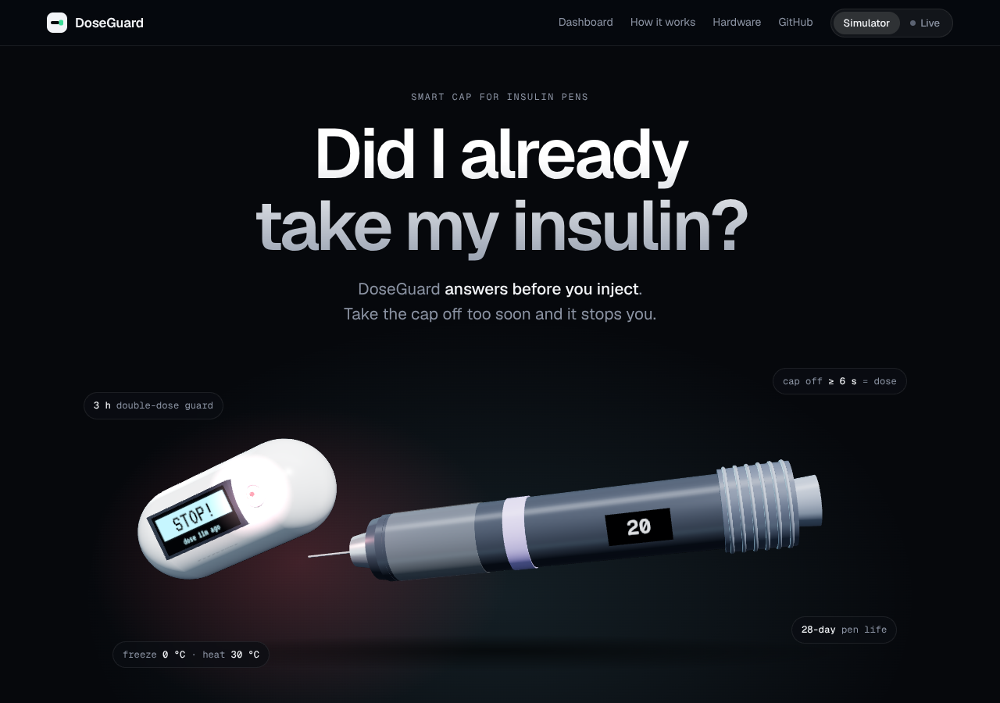
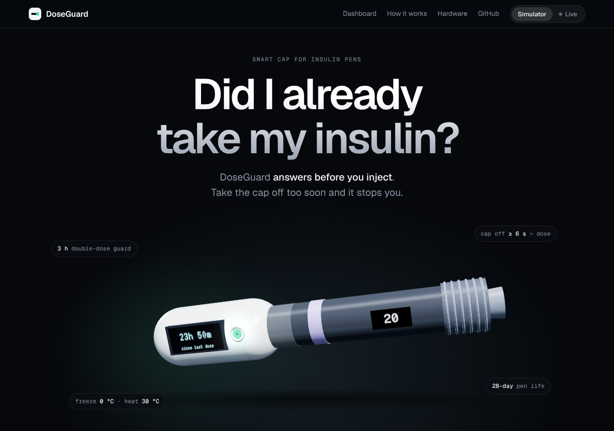
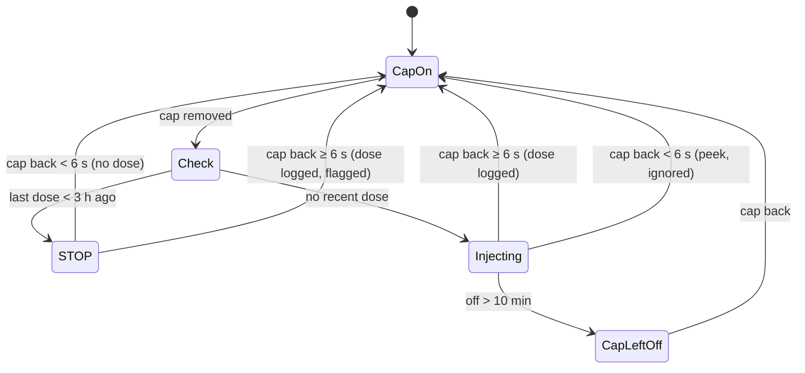
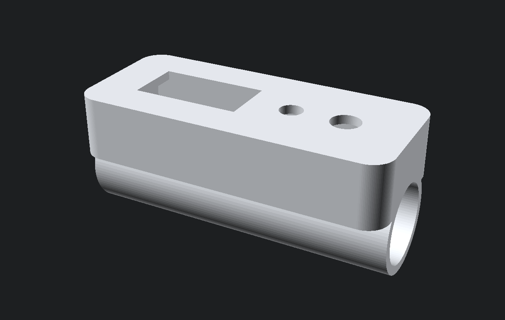

# DoseGuard

**A smart cap for insulin pens that stops double doses before they happen, catches missed doses and protects the insulin from heat and freezing.**

`ESP32` · `IoT` · `MQTT` · `Embedded C++` · `JavaScript` · `3D design` · `Wokwi`

**[▶ Try the live demo](https://salhace.github.io/doseguard/)** — take the cap off, inject, then try to inject again.

[](https://salhace.github.io/doseguard/)

---

## The problem

People who use insulin pens ask themselves the same question every day: **"Did I already take my insulin?"**

- **Double dose:** injecting twice can cause severe hypoglycaemia (dangerously low blood sugar).
- **Missed dose:** skipping a dose causes high blood sugar.
- **Damaged insulin:** insulin that froze or was left in a hot car loses its effect with no visible change. An opened pen is also only good for about 28 days.

Most pens give no feedback on any of this. DoseGuard is a cap that replaces the pen's normal cap. The pen needs no changes, and the patient's routine stays the same: take the cap off, inject, put it back.

## What it does

| | Feature | How |
|---|---|---|
| 🛑 | **Double-dose guard** | The moment the cap comes off, DoseGuard checks the last dose. Within 3 h it shows **STOP**, flashes red and beeps *before* the injection |
| 💉 | **Automatic dose log** | Cap off ≥ 6 s then back on = dose (an injection takes time). A quick peek is ignored. No buttons to press |
| ⏰ | **Missed-dose reminder** | Daily dose due at 21:00. Reminder starts 60 min late; after 12 h the day is logged as missed |
| 🌡️ | **Insulin health** | NTC thermistor in the cap: freezing = do not use, minutes above 30 °C are added up, and 28-day in-use countdown |
| 🧢 | **Cap-left-off reminder** | The pen needs its cap for protection |
| 💾 | **Survives power loss** | Dose log, pen age and heat log stored in flash (NVS) |
| 📡 | **Companion web app** | Live data over Wi-Fi + MQTT, so a parent or carer can follow along |
| 🕒 | **Real clock** | NTP time sync, Riyadh time zone |

## Companion app

The app in [`docs/`](docs/index.html) runs on GitHub Pages and has two modes:

- **Simulator:** a JavaScript twin of the firmware, with the same rules and thresholds. Click the cap, drag the temperature, skip ahead in time. Anyone can try DoseGuard from the link, no hardware needed.
- **Live device:** connects to the MQTT broker and mirrors the real cap (or the Wokwi simulation) in real time.

It shows the time since the last dose on a 3-hour guard ring, a replica of the cap's screen, a 14-day dose map (on time, late, double dose, missed), and insulin health.



## How the cap decides



Running in parallel while the cap is on:

| Check | Rule | Alert |
|---|---|---|
| Missed dose | No dose between 18:00 and 22:00 | Amber, double chirp every 8 s, snooze with button |
| Freezing | Temperature ≤ 0 °C | Purple flash, latched until a new pen |
| Heat | > 30 °C now / > 120 min in total | Amber warning |
| Pen age | > 28 days since the pen was started | Amber warning |

The time a dose is logged is the moment the cap came **off** (when the injection starts), not when it went back on.

## Hardware

| Part | Purpose | ESP32 pin |
|---|---|---|
| ESP32 DevKit C | Microcontroller with Wi-Fi | — |
| SSD1306 OLED 128×64 (I²C) | Cap screen | SDA 21, SCL 22 |
| Reed switch + magnet on the pen (slide switch in Wokwi) | Detects the cap on / off | GPIO 14 |
| NTC 10 kΩ thermistor module | Insulin temperature | GPIO 34 (ADC) |
| Push button | Snooze (short) / new pen (hold 3 s) | GPIO 13 |
| RGB LED (common cathode) + 3 × 220 Ω | Status light | R 26, G 27, B 33 |
| Buzzer | Alarms | GPIO 25 |

**Status light:** green heartbeat = all good · blue = cap off · green = injection long enough to count · amber = warning · red strobe = STOP.

### 3D-printable enclosure

[`hardware/doseguard_cap.scad`](hardware/doseguard_cap.scad) is a parametric OpenSCAD model (STL included). It has a sleeve for the pen, a bay for the electronics, an OLED window, LED and button holes, a reed-switch slot, a thermistor port next to the insulin cartridge and a USB-C opening. Change `pen_d` to fit any pen.



## Run it

### In Wokwi (no hardware)

1. Open [wokwi.com](https://wokwi.com) → new **ESP32** project.
2. Paste [`firmware/sketch.ino`](firmware/sketch.ino) and [`firmware/diagram.json`](firmware/diagram.json), and add [`firmware/libraries.txt`](firmware/libraries.txt).
3. Press **Play**. The slide switch is the cap: slide it to take the cap off, wait 6 s, slide it back. Do it again right away to see **STOP**.
4. Click the NTC sensor to change the temperature.
5. Open the companion app → **Live device** to watch it in real time.

> `DEMO_MODE 1` runs the clock 60× faster (1 second = 1 minute), so a whole day takes 24 minutes. Set it to `0` for real time.

### On real hardware

Same code. Set `DEMO_MODE 0`, put your Wi-Fi details in `WIFI_SSID` / `WIFI_PASS`, and flash with the Arduino IDE (board: ESP32 Dev Module). Libraries: Adafruit SSD1306, Adafruit GFX, PubSubClient.

## MQTT

| Topic | Retained | Content |
|---|---|---|
| `doseguard/pen-01/telemetry` | yes | Full state every 2 s and on every change |
| `doseguard/pen-01/log` | yes | Last 30 doses `[time, seconds_cap_off, flags]` and last 10 missed days |
| `doseguard/pen-01/events` | no | `dose`, `guard_warning`, `cap_peek`, `dose_missed`, `heat_start`, `frozen`, `new_pen`… |

```json
{"id":"pen-01","now":1793124900,"state":"OK","cap_on":true,"last_dose":1793124300,
 "since_min":10,"guard_left_min":170,"next_due":1793210400,"temp":24.1,
 "heat_min":0,"frozen":false,"pen_day":1,"pen_life":28}
```

Flags: `1` = dose taken inside the guard window (possible double dose), `2` = late.

## Testing

The alarm logic was tested by compiling the firmware on a PC against stub hardware and running a scripted two-day scenario:

```
[27/10 21:05] cap_off
[27/10 21:13] dose        hold 8 s
[27/10 21:44] guard_warning  since_min 39   → STOP
[27/10 21:46] cap_peek                      → not counted
[28/10 22:00] state MISSED                  → reminder
[28/10 22:15] missed_snoozed
[29/10 09:00] dose_missed
[29/10 09:05] heat_start → 11:05 heat_budget_exceeded
[29/10 11:18] frozen → 11:27 new_pen
```

## Project structure

```
doseguard/
├── firmware/
│   ├── sketch.ino        ESP32 firmware (Arduino C++)
│   ├── diagram.json      Wokwi circuit
│   └── libraries.txt
├── docs/                 Companion web app (GitHub Pages)
│   ├── index.html
│   └── images/
├── hardware/
│   ├── doseguard_cap.scad   Parametric 3D enclosure
│   └── doseguard_cap.stl
├── LICENSE
└── README.md
```

## Next steps

- Move to an ESP32-C3 + LiPo battery and Bluetooth Low Energy to fit the 3D-printed cap
- Read the dialed dose (units) with a small optical sensor on the dose window
- Push notifications to a carer's phone for STOP and missed-dose events
- Export the dose log as a PDF for the doctor or pharmacist

## Disclaimer

DoseGuard is a student engineering project. It is not a medical device, and it does not replace medical advice. Always follow your doctor's and pharmacist's instructions.

---

**Salha Alwahby** · Computer Engineering, Prince Sattam bin Abdulaziz University · MIT License
